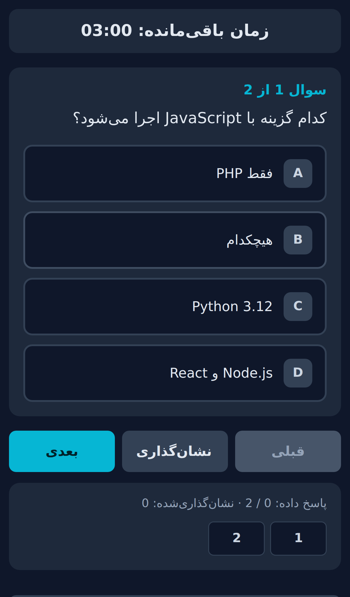

# Offline Exam System

**Build a multiple-choice exam from a CSV file and hand students a single HTML file. No server, no internet, no installation.**

Built for classrooms where connectivity is unreliable. English (LTR), Persian (RTL) and Arabic (RTL) are supported.

[**Open the ](https://mojahedjamei.github.io/offline-exam-system/admin.html) · [Sample CSVs](samples/) · [Full guide](GUIDE.txt) · [فارسی](#فارسی)



## How it works

1. The teacher opens `admin.html` and loads a CSV question bank.
2. They set the title, language, number of questions, duration and pass mark, then click **Generate exam file**.
3. The browser downloads one self-contained `exam_<title>_<timestamp>.html`. Send it to students by any channel (Telegram, WhatsApp, email, USB, LMS).
4. Each student opens it, takes the exam and downloads a `result_<id>_<timestamp>.json` to send back.

## Features

- **Offline.** The code contains no `fetch`, `XMLHttpRequest`, CDN, external font or analytics.
- **One file out.** The generated exam embeds the questions, timer and logic.
- **Three UI languages** with automatic RTL for Persian and Arabic (`dir="auto"` on questions and options).
- **Random subset per student** (Fisher–Yates). Optional: shuffle answer options per student.
- **Forgiving CSV import.** Comma or semicolon delimiter, quoted cells, `\n` / `\r\n` / `\r` line endings, UTF-8 BOM, `correct` as `0–3`, `A–D`, or Persian/Arabic digits. Invalid rows are reported to the teacher, not silently dropped.
- **Deadline-based timer** that does not drift in background tabs.
- **Progress is restored after a reload** (same name and student ID). If the time expired while the page was closed, the exam is finished immediately with the saved answers.
- **Result export:** file download, system share sheet (files), copy to clipboard, and a ready summary for Telegram, WhatsApp, Bale, Rubika and Eitaa. See *Sharing*.
- **XSS-safe rendering.** Questions, options, names and titles are HTML-escaped; the embedded config is Base64 so `</script>` cannot break out.
- **Pass mark** set by the teacher, 0–100 %, default **50**.
- **Teacher options:** share network and class link, save a copy of the exam file to Downloads, auto-save a copy of each student's result file, shuffle options, show correct answers after finishing.
- **Mixed-direction text:** English words inside Persian/Arabic questions and options are isolated (`<bdi>`) so word order stays correct.

## CSV format

```csv
text,optionA,optionB,optionC,optionD,correct,explanation
What does HTML stand for?,HyperText Markup Language,High Tech Modern Language,Home Tool Markup Language,Hyperlink Text Mode Language,0,HTML = HyperText Markup Language.
```

| Column | Meaning |
|---|---|
| `text` | The question |
| `optionA`–`optionD` | Choices. Empty choices are dropped and the rest re-lettered (at least 2 must remain, and the correct one must not be empty) |
| `correct` | `0`=A … `3`=D. Also `A`–`D` and `۰–۳` / `٠–٣` |
| `explanation` | Optional; stored in the result JSON |

Save from Excel as **CSV UTF-8**. The CSV content must already be in the exam language; nothing is translated.
Ready-made samples: [`sample_en.csv`](samples/sample_en.csv), [`sample_fa.csv`](samples/sample_fa.csv), [`sample_ar.csv`](samples/sample_ar.csv).

Rows are skipped and reported when `correct` is not valid, fewer than 2 options remain, or the correct option is empty. Rows with no question text are ignored silently. Reported numbers count CSV records, so they can differ from editor line numbers if a cell spans several lines.

## Result file

Each student's JSON contains name, ID, exam title and language, totals, score (0–100), pass mark and pass/fail, start/finish time, duration, and per-question details (question ID, chosen and correct answer, correctness, explanation). Question IDs are numbered in the order of valid CSV rows. Import with Excel (**Data → Get Data → From File → From JSON**) or Power BI.

If you paste names into a spreadsheet, prefix any value starting with `=`, `+`, `-` or `@` with `'` to avoid formula injection.

## Hosting the builder (GitHub Pages)

Settings → Pages → Deploy from a branch → `main` / `/ (root)` → Save. The builder will be at `https://YOUR-USERNAME.github.io/offline-exam-system/`. You can also just download `admin.html` and double-click it; no hosting is required.

## Sharing

- **System share sheet (best):** attaches the result file directly. Browsers only allow this on **HTTPS** pages (for example GitHub Pages) and on supported phones. It does not work when the exam is opened as a local `file://` file.
- **Fallback (local file, desktop, in-app browsers):** the result file is downloaded, a short summary is copied to the clipboard, and the teacher's class link (or the selected app: Telegram/WhatsApp open with the summary prefilled) is opened. Messenger links cannot attach a file, so the student attaches the downloaded file in the chat. Opening a messenger needs internet; downloading and copying do not.
- Bale, Rubika and Eitaa links open the app's website only; these were not tested. Paste your channel/group link in the builder for the most reliable result.
- The "save a copy to Downloads" options use a normal browser download; browsers cannot write to arbitrary folders.

## Limitations and security

Designed for **low-stakes** assessments between people who already trust each other.

- Questions and correct answers are inside the student's file; a technical student can extract them.
- Result JSON is plain text and can be edited. It is **not tamper-proof**.
- A student can start a new attempt by reopening the file with a different name/ID, or after finishing. There is no server to prevent this.
- Question order is always randomized; option order only if the teacher enables it.
- For anti-cheat, live monitoring or central storage you need a server-based design.

## Browser support

Modern Chrome, Edge, Firefox and Safari. Features used: `Blob`/`URL.createObjectURL`, `TextEncoder`/`TextDecoder`, CSS Grid, flex `gap` (Safari 14.1+), Unicode property escapes with an ASCII fallback, and `navigator.canShare` (optional).
Automated tests ran on Chromium (desktop, iPad, iPhone and Android profiles, online and offline). Firefox, Edge and real iOS Safari were not available for testing. Phone in-app browsers (Telegram, WhatsApp) differ widely in download support, so the result screen offers download, share and copy. Opening the file in the system browser is the most reliable option.

## Troubleshooting

| Problem | Fix |
|---|---|
| CSV will not load | Save as **CSV UTF-8**, not `.xlsx`. |
| "Encoding problem" | The file is not UTF-8 (often Windows-1256). Re-save as CSV UTF-8. |
| Questions missing | Read the warning; it lists skipped record numbers. |
| Persian/Arabic looks left-aligned | Regenerate and check the output language. |
| Result will not download on iOS | Use **Share Result** or **Copy Result**. |
| Share does not attach the file | Host the exam on HTTPS (GitHub Pages) or attach the downloaded file manually. |

## License

MIT, see [LICENSE](LICENSE). Author: **Mojahed Jamei**.

---

<div dir="rtl">

## فارسی

**آزمون چندگزینه‌ای را از یک فایل CSV بسازید و فقط یک فایل HTML به دانشجویان بدهید. بدون سرور، بدون اینترنت، بدون نصب.**

### روش کار
۱. `admin.html` را در مرورگر باز کنید و فایل CSV سوالات را بارگذاری کنید.
۲. عنوان، زبان، تعداد سوال، مدت و نمره قبولی را تنظیم کنید و «Generate exam file» را بزنید.
۳. فایل `exam_...html` دانلود می‌شود. آن را با تلگرام، واتساپ، ایمیل یا فلش بدهید.
۴. دانشجو فایل را باز می‌کند، آزمون می‌دهد و فایل نتیجه (JSON) را برای شما می‌فرستد.

### نکات مهم
- فایل CSV را با گزینه **CSV UTF-8** ذخیره کنید. محتوای سوالات باید از قبل به زبان آزمون باشد.
- نمره قبولی را استاد تعیین می‌کند (۰ تا ۱۰۰، پیش‌فرض ۵۰).
- ستون `correct` اعداد `۰–۳`، `0–3` و حروف `A–D` را می‌پذیرد.
- نمونه‌ها: [`sample_fa.csv`](samples/sample_fa.csv) و [`sample_ar.csv`](samples/sample_ar.csv).
- این سیستم برای آزمون‌های **کم‌ریسک** است: پاسخ‌ها داخل فایل دانشجو قرار دارند و فایل نتیجه قابل ویرایش است.
- اگر دکمه دانلود در مرورگر داخلی تلگرام یا واتساپ کار نکرد، فایل را در مرورگر اصلی گوشی باز کنید یا از «اشتراک‌گذاری» و «کپی» استفاده کنید.

</div>
